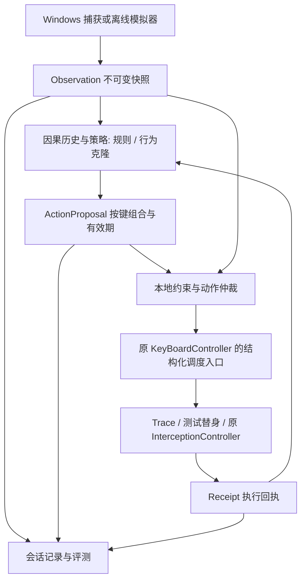

# 设计与开发架构

## 方案选择

v0.3 应用基础为已导入的 AutoLevelUp，按 [集成方案](autolevelup-integration.md) 增量开发。KeyBoardController 继续拥有唯一按键线程，InterceptionController 继续承担真实发键；新增模块不自建第二套输入驱动或常驻控制线程。

采用规则基线 → 真人配对采集 → 行为克隆动作模型的路线。模型直接预测允许键组合与更新间隔，不需要生成自然语言。首选候选为小型 GRU，比较单帧 MLP 基线；隐藏维度、历史窗口和更新周期通过验证数据与运行延迟决定，不能事先宣称最佳。半马尔可夫模型仅作为后续高层意图对照。

本地和远端运行同一动作策略接口。Windows 本机只需承担感知、输入执行和时效控制；训练可放在另一台机器。CPU 推理是需测试的部署选项，不把 1GB 显存当作神经模型能够运行的证明。

## 数据流



感知负责“看到了什么”，模型负责“此刻建议按哪些键”，本地仲裁负责协议与硬约束，调度器负责按下和释放。正常动作不再被固定路线策略二次决定。规则基线可调用原导航；可选高层策略可把 Intent 作为动作模型附加输入。不得同时启用两套正常走位决策。执行回执只证明输出调用结果，不能证明游戏已接受动作；成功效果必须由下一次观察确认。

## 增量代码目录（原应用保留，新增目录待创建）

```text
pyproject.toml
src/                        # 保留 engine、input、ui、utils、states
behavior_lab/               # 仓库根纯核心包，避免与原 src 包布局冲突
  cli.py
  core/                 # contracts、clock、rng、validation
  policies/             # deterministic、timing_jitter、behavior_clone、replay
  learning/             # dataset、causal_features、train、export、model_manifest
  navigation/           # 区域/连接、现有路线适配器
  runtime/              # observation_store、arbiter、scheduler、watchdog
  adapters/windows/     # 原感知/键盘控制器桥接、演示监听；不重写驱动
  recording/            # writer、manifest、sync、annotation、replay
  simulation/           # 固定地图、怪物和事件、观察限制
  evaluation/           # split、features、metrics、report
  remote/               # 动作提案客户端/服务端
configs/
fixtures/synthetic/
tests/{unit,integration,windows}/
spec/
```

核心只依赖标准库及必要的数值计算库；捕获、UI、Windows API 为可选依赖，延迟导入。运行基线选 Python 3.12；依赖在 Phase 1/2 实装时验证并锁定，不能把当前未锁版本直接当作复现环境。

原 run_gui.py 是用户运行入口；behavior_lab CLI 用于训练、回放、评测和测试。图中的“调度器”部署在原 KeyBoardController 内或由它调用的纯调度核心中，始终只有一个输出所有者。requirements.txt 维持原应用依赖，学习依赖单独提供，安装行为模型不强制执行机安装训练框架。

## 可选高层状态模型（不阻塞动作模型交付）

| 状态 | 入口条件 | 正常完成 | 中断示例 |
|---|---|---|---|
| PATROL | 有可达巡逻区域 | 抵达或驻留期结束 | 观察失效、目标事件 |
| APPROACH | 存在可信且可达目标 | 达到动作允许范围 | 目标消失、路径失效 |
| ATTACK | 目标存在且满足动作约束 | 目标消失或意图期限结束 | 观察失效、受限地形 |
| RECOVER | 位置偏离且有已知返回路径 | 观察确认返回 | 超时、路径不可达 |
| IDLE | 场景允许暂停 | 驻留时间结束 | 关键环境变化 |

LOOT 仅在能够观测掉落或有可靠人工标注时加入；不把定时按拾取键包装成“看见掉落后拾取”。STOP 属于运行时安全状态，不参与人格随机采样。

用有效候选集合约束转移：`P(next | state, elapsed, observation, profile)`。驻留分布设合理上下界，零/负/NaN 参数直接拒绝。首版只保留少量可解释参数，不能凭“谨慎”“疲劳”标签宣称已建模真实心理。

## 时间与并发

- 核心使用可注入单调时钟，离线使用虚拟时钟，不在策略里 sleep。
- 感知线程发布完整不可变快照；消费端只取最新快照，慢处理不能无限堆积旧画面。
- 动作调度单线程拥有按键状态；其他模块只提交意图/事件，不直接发键。
- 移动是可替换的期望 held-key 集合，tap 是一次性事件；action_id 去重。
- 录制队列有界，满时记录丢失统计，不能阻塞按键回调或静默丢输入。
- “决策提出时间”“调度接受时间”“实际调用时间”“观察效果时间”分别记录。
- 急停由本机处理；异常路径执行 release，硬件/驱动故障下释放失败要明确告警，不能声称绝对保证。

## 局域网推理

本机保留感知、仲裁和调度；远端返回短有效期 ActionProposal，包括 held_keys 与 tap 事件。远端不直接控制输入驱动。网络使用版本化消息、会话认证、消息大小限制，默认不监听公网。新观察覆盖旧请求，响应须匹配 session、request、frame、policy_epoch。观测发送不得阻塞本地急停。

两台机器单调时钟不可直接相减。期限由本机发送时刻加本地预算判断，往返超预算即丢弃；远端 duration 是相对值。断线、过期响应、重连旧 epoch 都进入 STOP，显式恢复后重新观察，不能自动重播缓存动作。

## 设计取舍

首版固定地图、职业与动作表，不声称覆盖新地图。模型使用平台/梯子/缺口及可达关系，只有位置而没有地形不足以决定有效移动。目标列表使用固定排序、截断上限和 padding mask，特征变换版本随模型一起发布。训练与推理共享同一个特征构建器。

序列只包含决策时已经可用的观察和历史动作，按时间而非假定固定 FPS 计算特征。GRU 在 session/场景切换、失焦、长时间缺帧或 epoch 变化时重置；远端丢帧保留 dt/missing 标记，不能伪装连续输入。输出包括合法键组合、tap 提议与有效期，非法组合由本地拒绝并记录。

模型过滤前、过滤后动作均进入评测，防止“模型经常出错但规则救回来”被算作模型成功。闭环偏移会让模型遇到训练中未见状态；通过受控模拟和补录失败场景验证，离线按键准确率不能替代闭环表现。远端化不能消除本机视觉瓶颈，记录捕获到实际输出的端到端延迟。

## v0.4 离线运行装配

运行时先解析 backend，再加载平台适配器。原 KeyBoardController 的纯调度逻辑可抽成可注入核心，Trace/Sim 复用它但不构造会初始化驱动的原对象。文件感知/合成观察替代 GameWindowCapturor；离线路径不触发任何真实窗口操作。自建输入反馈窗口作为原 Interception 后端的接收测试端，模拟器负责动作改变世界的闭环，两者不互相替代。详见 [离线规格](offline-validation.md)。
