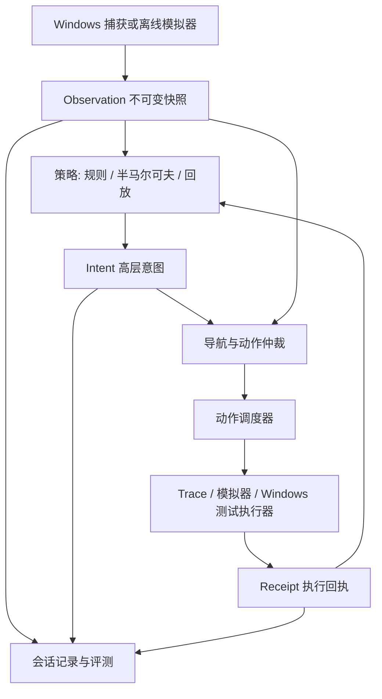

# 设计与开发架构

## 方案选择

采用条件半马尔可夫策略：每次进入状态时确定预计持续时间；每次接收新观察时检查硬中断、完成条件、有效动作集合和转移条件。持续时间到期触发重评估，不代表强制随机换状态。先人工配置参数用于工程实验，之后用真人数据校准。

轨迹回放作为对照；模仿学习留待数据足够后；局域网服务用于远端模型和集中实验，首版不用它解决小型状态模型的计算问题。

## 数据流



感知负责“看到了什么”，策略负责“当前要做什么”，导航负责“如何到达目标”，调度器负责“何时按下和释放”。执行回执只证明输出调用结果，不能证明游戏已接受动作；成功效果必须由下一次观察确认。

## 推荐代码目录（待创建）

```text
pyproject.toml
src/behavior_lab/
  cli.py
  core/                 # contracts、clock、rng、validation
  policies/             # deterministic、timing_jitter、semi_markov、replay
  navigation/           # 区域/连接、现有路线适配器
  runtime/              # observation_store、arbiter、scheduler、watchdog
  adapters/windows/     # capture、input_recorder、test_sink、target_adapter
  recording/            # writer、manifest、sync、annotation、replay
  simulation/           # 固定地图、怪物和事件、观察限制
  evaluation/           # split、features、metrics、report
  remote/               # 可选客户端/服务端
configs/
fixtures/synthetic/
tests/{unit,integration,windows}/
spec/
```

核心只依赖标准库及必要的数值计算库；捕获、UI、Windows API 为可选依赖，延迟导入。运行基线选 Python 3.12；依赖在 Phase 1/2 实装时验证并锁定，不能把当前未锁版本直接当作复现环境。

## 状态模型

| 状态 | 入口条件 | 正常完成 | 中断示例 |
|---|---|---|---|
| PATROL | 有可达巡逻区域 | 抵达或驻留期结束 | 观察失效、目标事件 |
| APPROACH | 存在可信且可达目标 | 达到动作允许范围 | 目标消失、路径失效 |
| ATTACK | 目标存在且满足动作约束 | 目标消失或意图期限结束 | 观察失效、受限地形 |
| RECOVER | 位置偏离且有已知返回路径 | 观察确认返回 | 超时、路径不可达 |
| IDLE | 场景允许暂停 | 驻留时间结束 | 关键环境变化 |

LOOT 仅在能够观测掉落或有可靠人工标注时加入；不把定时按拾取键包装成“看见掉落后拾取”。STOP 属于运行时安全状态，不参与人格随机采样。

用有效候选集合约束转移：`P(next | state, elapsed, observation, profile)`。驻留分布设合理上下界，零/负/NaN 参数直接拒绝。首版只保留少量可解释参数，不能凭“谨慎”“疲劳”标签宣称已建模真实心理。

## 时间与并发

- 核心使用可注入单调时钟，离线使用虚拟时钟，不在策略里 sleep。
- 感知线程发布完整不可变快照；消费端只取最新快照，慢处理不能无限堆积旧画面。
- 动作调度单线程拥有按键状态；其他模块只提交意图/事件，不直接发键。
- 移动是可替换的期望 held-key 集合，tap 是一次性事件；action_id 去重。
- 录制队列有界，满时记录丢失统计，不能阻塞按键回调或静默丢输入。
- “决策提出时间”“调度接受时间”“实际调用时间”“观察效果时间”分别记录。
- 急停由本机处理；异常路径执行 release，硬件/驱动故障下释放失败要明确告警，不能声称绝对保证。

## 可选局域网

本机保留感知、导航、仲裁和调度；远端只返回高层意图。网络使用版本化消息、会话认证、消息大小限制，默认不监听公网。新观察覆盖旧请求，响应须匹配 session、request、frame、policy_epoch。

两台机器单调时钟不可直接相减。期限由本机发送时刻加本地预算判断，往返超预算即丢弃；远端 duration 是相对值。断线、过期响应、重连旧 epoch 都进入 STOP，显式恢复后重新观察，不能自动重播缓存动作。

## 设计取舍

固定录制路线仍会限制宏观行为多样性；第一版只验证在该约束内的条件决策与持续时间，不声称覆盖全图真人行为。远端化不能消除本机视觉瓶颈。先测捕获、定位、模板匹配、策略、调度五段耗时，再决定是否迁移视觉计算。
